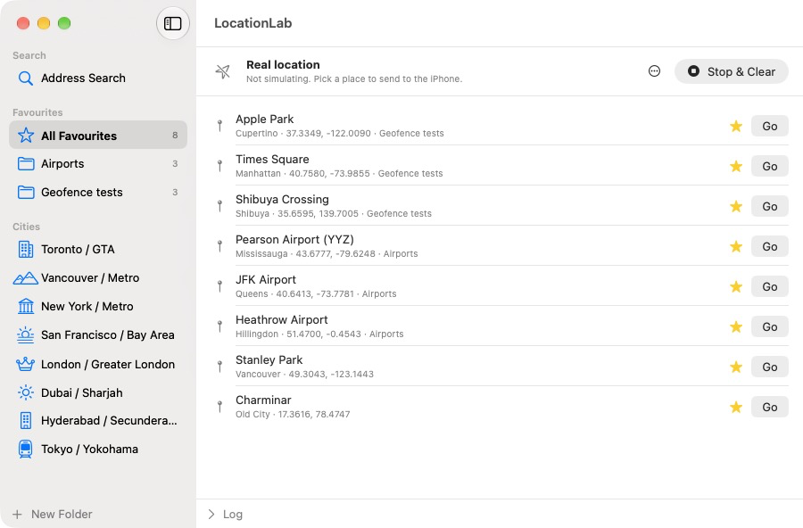

<p align="center">
  
</p>

<h1 align="center">LocationLab</h1>

<p align="center">
  <b>Simulate GPS on your iPhone for testing location-aware apps.</b><br>
  A small Mac app for iOS developers: pick a place and your connected iPhone's location moves there.<br>
  One click puts it back.
</p>

<p align="center">
  
  
  
  
</p>

<p align="center">
  
</p>

## Features

- **Built-in places**: 8 cities with 10–12 well-known places each (Toronto, Vancouver, New York, San Francisco, London, Dubai, Hyderabad, Tokyo). Click **Go** or double-click a row.
- **Favourites and folders**: star any place (built-in or from address search) to keep it in **Favourites**. Make your own folders with **+ New Folder** (<kbd>⇧⌘N</kbd>), then drag places onto a folder or right-click › **Move to Folder**. Drag to reorder.
- **Trim the built-in list**: delete places you don't use (select and press <kbd>Delete</kbd>, or right-click), or right-click a city › **Delete City…**. **Edit › Restore Deleted Places…** brings them all back.
- **Address search**: look up any street address or place name with Apple Maps (MapKit), then send it to the phone. Press <kbd>⌘F</kbd> to search from anywhere.
- **Stop & Clear** (<kbd>⌘.</kbd>): stops the simulation and restores the phone's real location. It works even if the phone was left on a fake location by an earlier session.
- **Safe quit**: quitting the app clears the simulated location first.
- **Readable errors**: common failures (phone locked, not paired, Developer Mode off, no device) are shown as plain-language messages, with the raw CLI output in a collapsible log.
- **Guided setup**: if `pymobiledevice3` isn't installed, LocationLab offers to install it for you into its own private Python environment (the exact commands and the PyPI source are shown first), or gives you the Terminal command to run yourself. If you already have it, it's found automatically; you can also set the path in Settings (<kbd>⌘,</kbd>).

The location is set system-wide, so Apple Maps and every other app on the phone see it, including the app you're testing.

## Requirements

- A Mac running **macOS 14 Sonoma** or later
- An iPhone on **iOS 17** or later, with **Developer Mode** on (Settings › Privacy & Security › Developer Mode), paired with and trusted by the Mac
- **[pymobiledevice3](https://github.com/doronz88/pymobiledevice3)**, which does the actual talking to the phone. On first launch LocationLab checks for it and offers to set it up:
  - **Install for Me** creates a private environment in `~/Library/Application Support/LocationLab/python` and installs `pymobiledevice3` from PyPI into it. Your own Python isn't touched and no admin password is needed.
  - Or install it yourself: `python3 -m pip install -U pymobiledevice3`
  - Python comes with Apple's Command Line Tools (`xcode-select --install`); the setup screen has a button for that too.

  Connect the phone by USB the first time and tap **Trust** when asked. After that, Wi-Fi works too.

## Install

### Download

Get the `.dmg` from [Releases](../../releases), open it and drag **LocationLab** into **Applications**.

Releases are signed with a Developer ID and notarized by Apple, so the app opens without security warnings.

### Build from source

1. Clone the repo and open `LocationLab.xcodeproj` in Xcode.
2. In the target's **Signing & Capabilities** tab, choose your own team (or *Sign to Run Locally*).
   **App Sandbox must stay off**: the app has to launch `pymobiledevice3` and, optionally, run `tunneld` as root.
3. Press <kbd>⌘R</kbd>.

To build a drag-to-install DMG:

```bash
./scripts/make-dmg.sh             # local build, runs on your own Macs
./scripts/make-dmg.sh --release   # Developer ID signed + notarized (needs a paid developer account)
# → dist/LocationLab <version>.dmg
```

See the comments at the top of `scripts/make-dmg.sh` for the one-time setup `--release` needs.

## Usage

1. Connect and unlock the iPhone.
2. Pick a city, a favourites folder or **Address Search** in the sidebar, then click **Go** next to a place (or double-click it).
   The status bar shows *Setting location…* and then the active place.
3. Pick another place to move again.
4. Click **Stop & Clear** (<kbd>⌘.</kbd>) to go back to the real location.
   The phone can take 10–20 seconds to get its real GPS fix back.

## How it works

LocationLab is a SwiftUI front end for `pymobiledevice3`:

| Action | Command |
| --- | --- |
| Set | `pymobiledevice3 developer dvt simulate-location set -- <lat> <lon>` |
| Clear | `pymobiledevice3 developer dvt simulate-location clear` |

- Recent versions of `set` stay running to hold the location; older ones set it and exit. The app handles both, and stops the previous process before starting a new one.
- `clear` sends its stop message without waiting for a reply and exits right away, which can drop the message before it reaches the phone. The app runs the same command with the connection kept open for a moment afterwards, so the clear actually lands.
- Recent `pymobiledevice3` versions open their own no-root tunnel for each command, so the root `tunneld` daemon is **optional**. If commands can't reach your phone, start it from the **•••** menu in the status bar (asks for your admin password).

## Troubleshooting

| Problem | Fix |
| --- | --- |
| *pymobiledevice3 isn't set up* | Click **Set Up…** in the banner (or Settings › **Open Setup…**). If you installed it yourself, run `which pymobiledevice3` in Terminal and paste the path into Settings. |
| *No iPhone found* | Connect by USB, unlock the phone, and check it trusts this Mac. |
| *Developer Mode is off* | iPhone Settings › Privacy & Security › Developer Mode, then restart the phone. |
| Phone still shows the fake location | Wait ~20 s for a GPS fix. If it's still stuck, click **Stop & Clear** again, or turn Location Services off and on. |
| Commands time out | Try starting `tunneld` from the **•••** menu. |

The **Log** pane at the bottom of the window shows the full CLI output for every command.

## Your data and uninstalling

Favourites, folders and deleted built-ins are saved in `~/Library/Application Support/LocationLab/library.json` (Settings › **Show in Finder**). A copy of `pymobiledevice3` installed by LocationLab lives in the `python` folder next to it.

To uninstall, quit LocationLab, drag it to the Trash, and delete `~/Library/Application Support/LocationLab`.

## Roadmap

- Add your own places and cities (custom coordinates)
- JSON import/export of places and favourites
- Simulated routes (move along a path)

## Project layout

```
LocationLab/
├── App.swift                 SwiftUI app, window, sidebar, place lists, settings
├── LocationController.swift  Runs pymobiledevice3, tracks state, tunnel control, error mapping
├── Library.swift             Favourites, folders and deleted built-ins (saved as JSON)
├── Setup.swift               First-launch setup: finds Python, installs pymobiledevice3
├── AddressSearch.swift       MapKit address search (suggestions + lookup)
└── Places.swift              Place / City models (Codable) and the built-in list
scripts/make-dmg.sh           Release build + DMG packaging
```

## Disclaimer

LocationLab is a developer tool for testing apps you develop on devices you own. Only use it where you're allowed to; some apps and services prohibit faking your location. It isn't affiliated with or endorsed by Apple.

## License

[MIT](LICENSE) © 2026 Nouman Khan
